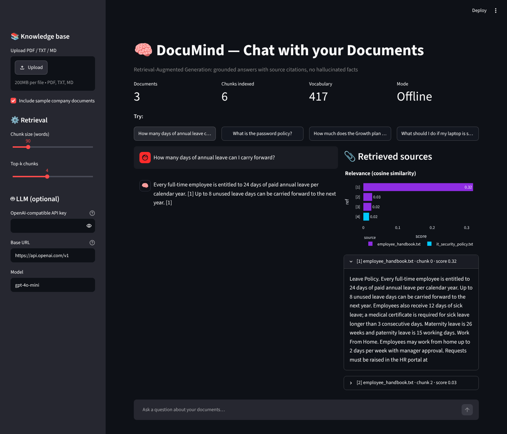
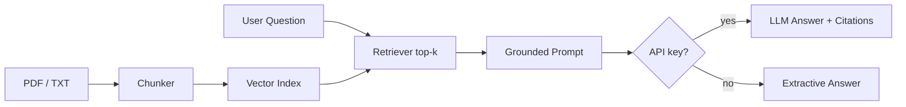

<div align="center">

# 🧠 DocuMind — RAG Chatbot: Chat with your Documents

**Ask questions in plain English and get grounded answers with source citations — works with any OpenAI-compatible LLM, or fully offline.**

    

`Generative AI · Retrieval-Augmented Generation`

</div>

---



## 📌 Problem Statement

LLMs hallucinate and don't know your private documents. RAG retrieves the relevant passages first and forces the model to answer only from them.

## ✨ Key Features

- Upload **PDF / TXT / MD** files — or use the built-in company knowledge base
- Overlapping **chunking**, TF-IDF vector index with light stemming, top-k retrieval
- Grounded prompt with **numbered citations** `[1] [2]`
- Works with **OpenAI, Groq, Together, Ollama, LM Studio** (any `/v1/chat/completions` endpoint)
- **Offline extractive mode** when no API key is set — the demo always works
- Relevance chart and expandable source passages for full transparency

## 🏗️ Architecture



## ⚙️ How It Works

1. **Ingest** → documents are parsed (pypdf) and split into overlapping word windows.
2. **Index** → chunks are vectorised; the query is vectorised with the same analyzer.
3. **Retrieve** → cosine similarity returns the top-k chunks.
4. **Generate** → a system prompt restricts the LLM to the retrieved context and requires citations; without a key, the best-matching sentences are returned.

## 🧰 Tech Stack

| Layer | Tools |
|---|---|
| Language | Python 3.10+ |
| ML / Logic | pandas, numpy, scikit-learn, pypdf, requests |
| UI & Visualisation | Streamlit, Plotly |

## 📁 Project Structure

```
RAG-DOCUMENT-CHATBOT/
├── app.py             # Chat UI, sidebar settings, source viewer
├── rag.py             # Chunking, vector store, retrieval, prompt, generation
├── sample_docs.py     # Demo knowledge base & sample questions
├── assets/              # screenshots
├── requirements.txt
└── README.md
```

## 🚀 Getting Started

```bash
git clone https://github.com/PreciousBharath/RAG-DOCUMENT-CHATBOT.git
cd RAG-DOCUMENT-CHATBOT
python -m venv venv && source venv/bin/activate   # Windows: venv\Scripts\activate
pip install -r requirements.txt
streamlit run app.py
```

Open **http://localhost:8501** in your browser. Optionally set `OPENAI_API_KEY` (and `OPENAI_BASE_URL` for other providers) instead of typing the key in the sidebar.

> The project ships with a realistic built-in demo dataset, so it runs out of the box with no downloads or API keys.

## 🗺️ Roadmap

- [ ] Dense embeddings + FAISS / ChromaDB
- [ ] Conversation memory & follow-up questions
- [ ] Answer evaluation with RAGAS

## 👨‍💻 Author

**Bharath** — Software Developer · Project Engineer · Technical Trainer

[](https://linkedin.com/in/connectbharath)
[](https://itsbharathportfolio.netlify.app)
[](https://github.com/PreciousBharath)

⭐ If this project helped you, please give it a star!

## 📄 License

Released under the [MIT License](LICENSE).
